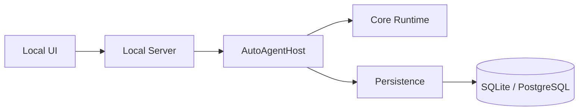

# V2 Local UI 分步实施计划

更新日期：2026-10-11。

状态：步骤 1 已实现，已交付独立 Server、可嵌入 Router 和 Workflow 定义查看 UI。
执行记录查看、父子导航和详情查询留在后续步骤。

## 1. 本阶段目标

先实现一个可以查看本地 Workflow 定义和执行记录的只读 UI。
每次只推进一个明确步骤，完成该步骤的验证后，再继续下一步。

最小查看流程：

> 浏览 Workflow 和历史 Revision → 查看定义图 → 找到一次 Root 执行 →
> 浏览父子 Invocation → 查看 Node、Operator Call、Edge 和 Wait 的详情。

首版包括：

- 当前已注册 Workflow 与持久化的历史 Revision。
- 历史定义图，以及 Node、Edge、Operator 或 System Command 的定义。
- 分页 Root 执行列表，按 Workflow、Revision、Session 和状态筛选。
- Root 与 Child Invocation 的关系导航。
- 当前已持久化的执行状态、具体 Node Occurrence、Call 和等待项。
- 小数据详情、大数据元信息和有界预览。
- 手动刷新、可直接打开的详情 URL、加载与错误状态。

首版不实现：

- Timeline、历史游标、回放播放和任意历史时刻的完整 Context 重建。
- SSE、自动刷新、`accepted` 数据视图。
- 新执行、暂停、继续、取消、审批响应和发送 Signal。
- Agent 对话、Tool 专用展示、Signal 交互连线。
- 图编辑、断点、单步、Fork、Context 修改。
- 中心化平台、Pod、Git、Coding Agent、CI/CD、统计看板。
- 手动加载、卸载、Checkpoint 管理和数据库维护页面。

## 2. 当前基础与缺口

以当前 V2 源码为准，V1 只作为交互和算法参考。

| 部分 | 当前能力 | 首版需要补充 |
| --- | --- | --- |
| Core | Workflow、父子执行、Wait、Signal、Timer、Select、暂停恢复 | 本阶段不修改运行语义 |
| Host | Workflow 目录与历史定义、执行控制、驻留管理 | 用于 UI 的只读执行查询 |
| Persistence | Revision、执行、Node、Call、Wait、Edge 和图变化查询 | Root 列表筛选、组合读取、有界数据预览等必要查询 |
| Server | FastAPI 独立应用 / Router、定义 API、静态 UI 托管 | 只读执行查询 API |
| UI | Workflow 目录、历史 Revision、定义图、Node / Edge 定义详情 | 执行查看页面 |

现有 Host 的 `get_execution` 返回运行结果边界，可能查询驻留的 Core。
Trace 查询应单独提供持久化视图，不用它替代执行记录查询，也不改变它的语义。

Persistence 的详情接口目前会展开数据引用。不能直接把它们接到浏览器，
否则查看一个详情就可能读取、传输和缓存完整 Artifact。

## 3. 模块边界



- UI 只调用 Server，不直接访问 Core 或数据库。
- Server 使用公开 Host 接口，不访问 Host 私有字段或自行管理 Session。
- Host 负责组织查询、校验对象归属、提供稳定返回模型。
- Persistence 负责 SQL、过滤、分页、一致读取和数据引用解析。
- Server 使用一个 Host 实例，不能为每个请求创建 Host 或 DatabaseSink。

只读指本阶段 HTTP 接口不提供执行命令。Host 既有自动调度仍可正常工作；
查询本身不得触发加载、恢复、执行或刷新 Session 的驻留热度。

## 4. 首版页面

### 4.1 Workflow 目录与定义

按 Workflow 浏览当前注册定义及历史 Revision，显示版本、Revision 标识和
“当前可执行 / 历史定义”。选择 Revision 后显示对应定义图。

点击 Node 或 Edge 打开定义详情，展示 Contract、映射、绑定、恢复规则、
Map、Stream 和 System Command 配置中实际存在的信息。

本阶段图可缩放、移动视口和拖动布局；拖动只改变展示位置，不修改 Workflow。
布局按定义缓存，切换执行状态不会重新排图。

V2 当前 Snapshot 没有 V1 的完整内嵌 SubWorkflow 分组信息。
第一版展示编译后的平面图和实际 Node ID，不拆分 ID 猜测层级。
补充可靠分组元信息和折叠容器留到后续。

### 4.2 Root 执行列表

默认只列 Root Invocation，避免 Child 占满列表。
列表提供 Workflow、Revision、Session 和状态筛选，以及直接输入执行 ID 查找。

每行展示：Workflow、Revision、Session ID、Invocation ID、入口 Node、
开始 / 结束时间、执行状态、控制状态和可用的错误摘要。

Session 下多次执行分别列出；选择一次执行不会自动跳到同 Session 的最新执行。
分页在数据库中完成，不先读取全部 Invocation 再过滤。

### 4.3 执行查看工作台

```text
顶部：Root 标识、当前选中 Invocation、状态、Revision、手动刷新
左侧：Root / Child 执行关系，可收起
中间：选中 Invocation 实际使用的 Workflow 定义图及状态汇总
右侧：选中 Node / Occurrence / Call / Edge / Wait 的详情
```

暂时没有底部 Timeline。执行页和历史定义页复用图与定义详情组件。

状态汇总与具体执行实例分开：

- Node ID 表示定义；`invocation_id + occurrence_id` 表示具体执行。
- Node 可展示运行、完成、失败等数量及最近一次执行状态。
- 点击 Node 后分页选择 Occurrence，展示其 Scope、Loop 迭代和 Calls。
- Map Call 通过 `call_id`、`unit_index` 区分。
- Edge 默认展示定义；选择来源 Occurrence 后展示对应选择 / 跳过记录。
- 不把某次选中的 Edge 当成所有迭代都选中，也不把未执行当成跳过。
- Child 使用自己的 Invocation、Revision 和图；内嵌 SubWorkflow 不伪装成 Child。

Root 的 `status`、`pending_outcome` 和 `control_state` 分别解释。
例如 `settling` 显示为正在收尾，`pausing` 显示为暂停中，不能提前显示为结束或已暂停。
计划中的 Child 显示计划状态，不能把缺失执行状态解释为已经运行。

## 5. 统一查询约定

本节确定语义。以下新增 Host 名称和 HTTP 路径是拟议接口，
各实施步骤开始时核对签名；未列出的查询不提前实现。

### 5.1 数据视图与一致性

- 首版只读 `durable` 视图，页面注明展示的是已持久化数据。
- Buffered 模式下，刚发生的变化可能尚未出现在页面，手动刷新不强制 flush。
- 一次组合响应里的记录和 `frontier` 来自同一个读取视图。
- 分页游标不是全局历史快照。运行期间跨页状态可能变化，归并时按完整标识去重。
- 手动刷新更换查看版本，清理当前页面依赖的旧游标和详情缓存。
- 如果图或列表只加载了部分实例，应明确标记；不根据不完整页面推导总数。
- 统计数量通过数据库聚合取得，不为了计数加载全部历史实例。

### 5.2 身份与归属

- 查询图使用 Invocation 保存的 Revision，不使用当前最新定义替代。
- 所有 Child、Occurrence、Call、Wait 和数据引用都校验其所属 Root / Invocation。
- Child 链接可解析到对应 Root，并保留选中的 Child。
- 历史定义无需仍然注册；可查看历史不代表可以执行或恢复它。
- Operator 详情优先使用 Call 绑定的 Operator Definition。
- 现有快照不是历史源码归档；可以显示已有定义和代码位置，不承诺恢复旧代码。

### 5.3 分页与数据大小

- 列表都使用稳定排序和游标分页，禁止无界数组。
- Server 将 Host 游标编码为不透明字符串，UI 不理解 SQL 排序元组。
- 列表和图状态只返回元信息、计数及数据句柄，不带完整输入输出。
- Node、Call、Wait 等详情也默认返回有界预览。
- 区分值为 `null`、没有记录、尚未产生、预览被截断和无法提供预览。
- 大 Artifact 先展示类型、逻辑大小和内容标识，不自动完整展开。
- 数据句柄由 Host 校验，UI 不能通过任意表名 / JSON 路径读取数据库。
- 不能先调用完整 `resolve` 再截断结果来声称有界读取。
- 无法有界读取的内容返回元信息和预览不可用原因；完整下载后续增加。

### 5.4 配置与缓存

Server 新增设置沿用 `.env` 与环境变量读取规则，进程环境变量优先。
设置写入 `.env.example`，不使用 `autoagent_project.py`。

在相应步骤加入监听地址 / 端口、分页上限、预览限制、查询超时等实际使用的配置。
默认监听本地地址。前端从 Server 获得适用的限制，不重复硬编码后台参数。

浏览器缓存限制页面数量和数据大小，详情关闭或切换执行后允许释放。
不复制 V1 部分详情和 Artifact 的无限缓存设置。
服务端不建立无界 Trace 缓存，也不为所有历史执行保留内存投影。

## 6. 分步实施

按可用的纵向链路逐步实现。每步完成后记录验证结果和未解决问题；
本计划不授权在一次任务里自动完成全部步骤。

### 步骤 1：独立 Server 与 Workflow 定义查看 UI（已完成）

目标：先交付一条可以启动并在浏览器使用的查看链路。
复用 Host 已有的定义查询，当前不新增执行查询。

实现范围：

- 在 V2 增加 `autoagent/server/`，使用 FastAPI / Uvicorn。
- `create_app()` 创建独立应用；`create_router()` 可绑定到其他 FastAPI。
- 项目启动模式拥有 Host；传入 Host 或嵌入 Router 时由调用方管理生命周期。
- 项目启动复用 `AutoAgentHost.from_project` 的装饰器 / TOML / env 行为。
- Server lifespan 只管理其拥有的 Host；借用 Host 不重复打开或关闭。
- 增加 Server 可选依赖及必要包装配置，不引入 V1 包。
- 明确如何启动 Server，初期可以使用 Python 模块入口，无需先做完整 CLI。
- 编码游标、校验参数、返回结构化错误；未知 API 返回 API 错误。

本步 HTTP 接口：

| 方法与路径 | 用途 |
| --- | --- |
| `GET /api/v2/workflows` | 当前定义 / 历史 Revision 分页 |
| `GET /api/v2/workflow-revisions/{revision_id}` | 历史定义与当前可执行标记 |

必要的连接信息由 Server 提供，不新增 Host 的 `start`、`health` 或 `flush` API。
Revision ID 等路径参数必须正确编码。

验收：

- HTTP 返回与 Host 查询一致，游标无遗漏和重复。
- 无效参数、未知记录、Host 不可用能得到明确错误。
- 重复请求不会创建 Host / DatabaseSink 或执行任务。
- Server 启动和退出正确管理其拥有的资源。
- 本阶段没有执行、暂停、继续、Signal 或审批 HTTP 路由。

正常启动同时提供 API 和已构建 UI，不需要另开 Vite。
`mount_ui()` 可以为嵌入应用单独挂载 UI；API 和 UI 路径可配置。
缺少构建资源时明确报错；`--no-ui` 可只提供 API。


实现范围：

- 在根目录增加一个 `ui/` 前端工程：React、TypeScript、Vite。
- 使用 TanStack Query 管理请求，React Flow + ELK 显示定义图。
- 建立 Workflow 目录、Revision 选择和定义详情。
- Node / Edge 选中、缩放、适配视口、布局缓存和加载回退。
- 支持定义页面直达 URL、刷新和浏览器前进 / 后退。
- 加入空目录、错误、加载和定义图无法布局的展示。
- 开发通过代理访问 Server；构建产物由 Server 托管。
- SPA 回退只处理页面路径，不吞掉 `/api/` 错误。

使用 ELK Worker 排列节点，迁移 V1 的避障连线算法并按 V2 类型验证。
不复制 V1 App、事件 reducer、执行表单或旧 API 适配层。

验收：

- 当前与历史 Revision 均能打开，未注册历史仍可查看。
- 节点、边、入口和定义内容与 Snapshot 一致。
- 并行边、回边、自环可辨认，布局失败仍可查看定义。
- 浏览器刷新不会丢失所选 Revision。
- 前端构建与 Server 静态资源托管可运行。

交付：Workflow 定义查看页面；此时可以单独停下来检查交互。


### 步骤 2：执行目录的 Host 查询与 HTTP 接口（待实施）

目标：建立 Root 执行目录的持久化只读入口，为执行 UI 提供 HTTP 查询。

实现范围：

- 新增 `list_executions`：Root 列表，支持 Workflow、Revision、Session、状态、分页。
- 新增 `get_execution_record`：读取指定 Invocation 的持久化元信息、Root 归属和数据句柄。
- 固定返回字段、排序、分页、缺失记录和错误语义。
- 为 Persistence 补充必要的 Root 过滤和元信息查询，不增加无关表。

拟议参数：

```python
await host.list_executions(
    workflow_id=None,
    revision_id=None,
    session_id=None,
    status=None,
    limit=50,
    cursor=None,
)
await host.get_execution_record(invocation_id)
```

列表与记录均不自动展开输入、输出、错误详情或等待请求。
现有 `get_execution` 与执行控制接口保持各自语义。

验收：

- SQLite 和 PostgreSQL 的筛选、分页和排序一致。
- Root 列表不混入 Child；同 Session 多次执行可分别查看。
- 已卸载执行和未注册的历史 Revision 可以查询。
- 读取不改变 Core 的 Session 驻留集合、执行进度或驻留热度。
- 大输入输出不进入列表响应；只读 durable 不暴露队列中尚未提交的数据。

Server 增加 `GET /api/v2/executions` 和
`GET /api/v2/executions/{invocation_id}`，复用已实现的分页、错误和生命周期规则。

交付：Host 只读执行目录、对应 HTTP 接口及数据库测试。

### 步骤 3：Root 执行目录 UI（待实施）

目标：从 Workflow 或全部历史记录找到一次 Root 执行。

- Root 列表按 Workflow、Revision、Session 和状态筛选并分页。
- 使用步骤 2 的 HTTP 接口，显示元信息和 Root 详情链接。
- 刷新、空状态、错误与 URL 状态沿用定义浏览页的规则。
- 不自动展开输入输出，也不加载运行中的 Core Session。

验收：同 Session 的不同 Root 可以区分，卸载后的执行仍可查看，
未注册 Revision 的执行可以打开其准确历史定义。

交付：执行目录页面，父子导航在下一步补充。

### 步骤 4：执行列表、父子导航和状态图

目标：在已实现的执行目录上增加父子导航和状态图。

新增 Host 查询职责：

- `list_execution_members`：分页查询 Root 成员及父子关系，可按父 Invocation 展开。
- `get_execution_graph`：选中 Invocation 的历史定义与轻量 Node 状态汇总。
- 必要的记录查询增加成员归属检查。

图查询的定义、汇总和 `frontier` 在一次一致读取中组成。
每个 Node 的计数来自完整查询聚合，不从浏览器已加载的 Occurrence 页面计算。
成员导航按需展开，不一次性读取所有后代和所有历史节点。

Server 暴露对应只读成员和图接口。前端扩展 Root 工作台，
增加 Child 选择与状态图，复用已实现的执行列表和筛选。

Edge 此步保持静态定义展示；具体执行的选择 / 跳过详情在步骤 5 加入。
不为了给所有 Edge 上色提前加载全部 `graph_changes`。

验收：

- 同 Session 的不同 Root 不混合，各 Child 归属正确。
- Child 可以切换图，直接打开 Child URL 能找到其 Root。
- 运行、等待、收尾、失败、取消、暂停中和已暂停正确区分。
- Child 计划状态与实际执行状态正确区分。
- 手动刷新显示新的 durable 状态，布局和用户选择尽量保留。
- 刷新没有新状态时不跳转到别的执行，也不推进 Runtime。
- 页面没有 Timeline、自动刷新或执行控制按钮。

交付：执行目录与父子执行查看工作台。

### 步骤 5：对象详情与有界数据预览

目标：能解释某个 Node、Call、Edge 或 Wait 发生了什么。

逐项增加公开 Host / Server 查询：

| 对象 | 列表 / 选择 | 详情 |
| --- | --- | --- |
| Node | 按 Node ID 分页 Occurrence，支持 Scope 定位 | 定义、状态、阶段、Scope、输入输出句柄、错误、恢复次数 |
| Call | 按 Occurrence 分页 | Operator Definition、unit index、状态、排队 / 执行时间、数据与错误 |
| Edge | 按来源 Occurrence 定位并分页 | 定义、条件结果、实际路由选择、关联来源 |
| Wait | 当前 / 历史等待项分页 | 类型、请求、响应、状态、截止时间、所属 Node |
| 数据 | 对象返回的数据句柄 | 类型、大小、有限预览、截断 / 可用状态 |

继续复用投影与数据引用，避免复制大数据到新的投影字段。
必要时补充 Persistence 的过滤与索引，不为了 UI 提前增加新的事实表。
Edge 条件计算与最终路由选择分别解释，不能互相替代。

前端加入右侧 Inspector、Occurrence 选择、Call / Wait 列表、JSON 预览与复制。
没有数据的字段明确显示缺失原因；缺失耗时不填零。
Node 整体耗时和 Operator 实际执行耗时分开标注。

验收：

- Loop 多次执行和 Map 多个 Call 能精确选择，不只显示最后一次。
- Edge 显示所选来源 Occurrence 的结果，不混入其他迭代。
- 外部 Wait、Timer、AwaitSignal 和 Select 可以查看，没有响应或发送按钮。
- 大 Artifact 不被自动完整解析、传输或长期缓存。
- 输入 / 输出为 `null` 与尚未产生输入 / 输出可以区分。
- 非所属对象和数据句柄不能串到别的 Root。
- 详情切换后旧请求结果不会覆盖新选择。

交付：完整的基础只读详情查看能力。

### 步骤 6：首版端到端验证

目标：确认定义、数据库、Host、Server 和浏览器展示是一致的。

实现范围：

- 提供可重复运行的 V2 Host 示例，用脚本产生记录，UI 负责查看。
- 示例覆盖并行、Loop、Map、父子任务、失败和不同等待状态。
- 包含同 Session 多次执行、旧 Revision、卸载后的执行及大数据。
- 示例数据不依赖真实 LLM / Tool 服务；不修改归档 V1。
- 检查页面 URL、手动刷新、网络失败、空状态和大量实例分页。
- 记录可复用的启动、造数和验证命令。

验证安排：

- 修改查询时跑相应 Persistence / Host 测试，数据库相关路径覆盖 SQLite 与 PostgreSQL。
- 修改 Server 时跑 HTTP、生命周期和静态托管测试。
- 修改 UI 时跑必要的状态 / 身份 / 分页测试、类型检查和生产构建。
- 端到端在浏览器验证“目录 → 定义 → Root → Child → Occurrence → Call / Edge / Wait”。
- 首版整合完成后运行完整 V2 Python 测试，检查 Core 与驻留策略没有回归。

交付：可以启动、造数、查看和重复验证的基础 Local UI。

## 7. 后续阶段

以下顺序是后续讨论的起点，不属于基础查看首版的实施范围。

1. Runtime Event / User Event 分页查看、筛选和对象定位。
2. 自动刷新与 SSE，补齐首次快照、增量、断线恢复和慢客户端处理。
3. Timeline 与历史图回放，再审查按历史游标读取详情的语义。
4. Debug 操作：执行、暂停、继续、取消、响应 Wait、发送 Signal。
5. Agent 事件规范稳定后增加消息和 Tool 专用视图。
6. 再讨论完整 Context、执行比较、统计和中心化平台复用。

## 8. 实施记录

| 步骤 | 状态 | 验证与备注 |
| --- | --- | --- |
| 1. Server 与定义 UI | 已实现 | 独立启动、嵌入 Router、历史定义、图布局及深链接 |
| 2. 执行目录查询与 API | 待实施 | 下一步从这里开始 |
| 3. Root 执行目录 UI | 待实施 | 依赖步骤 2 |
| 4. 执行工作台 | 待实施 | 父子关系与状态 |
| 5. 对象详情 | 待实施 | 完成基础查看范围 |
| 6. 端到端验证 | 待实施 | 首版验收 |

后续任务按步骤指定范围；出现新的必要接口时在对应步骤中补充，
不顺带实现 Timeline、Debug 或中心化功能。


## 9. 当前启动与嵌入方式

从仓库根目录准备 Python 依赖，再构建前端：

```bash
uv pip install --python .venv/bin/python -e '.[server]' httpx
cd ui
npm ci
npm run build
cd ..
.venv/bin/python -m autoagent.server --project examples/local_ui_demo
```

访问 `http://127.0.0.1:8765/`；API 位于 `/api/v2`，OpenAPI 位于 `/docs`。
示例通过装饰器发现 Workflow，只注册定义，不提交执行。
正常启动使用构建文件；开发前端可以在 `ui/` 运行 `npm run dev`。
开发代理默认指向 8765，可用 `AUTOAGENT_SERVER_URL` 覆盖。

其他 FastAPI 中可以借用同一个 Host，生命周期由外部应用拥有：

```python
from contextlib import asynccontextmanager
from fastapi import FastAPI
from autoagent.host import AutoAgentHost
from autoagent.server import ServerSettings, create_router, mount_ui

host = AutoAgentHost.from_project("my-project")
settings = ServerSettings(api_prefix="/autoagent/api", ui_path="/autoagent/ui")

@asynccontextmanager
async def lifespan(app):
    async with host:
        yield

app = FastAPI(lifespan=lifespan)
app.include_router(create_router(host, settings=settings))
# 先注册其他业务路由，再挂载 UI。
mount_ui(app, settings=settings)
```

Server 设置读取项目 `.env` 和进程环境变量，进程值优先。
监听地址、端口、API / UI 前缀、UI 目录、分页和查询超时均在根 `.env.example` 中。
更改 Router 挂载位置时，使用对应的 `ServerSettings`，UI 会注入正确的 API 地址。
构建前端后再构建 Python 包，wheel 携带静态资源，安装运行不依赖 Node。
源码包同时保留独立 `ui/` 源码；源码开发首次运行前需要构建 UI。


### 步骤 1 验证记录

- 完整 V2 Python 测试：719 项通过，包含真实 PostgreSQL 14.24 集成测试。
- Server 新增 21 项测试：SQLite 9 项、PostgreSQL 9 项、设置 / 资源 3 项。
- 前端 5 项测试通过：深链接、平行边、回边、自环、布局回退和拖动避障。
- TypeScript 类型检查与 Vite 生产构建通过。
- 浏览器验证独立启动、Node / Edge 选择、刷新与前进 / 后退。
- 浏览器验证嵌入 `/tools/autoagent/` 的 UI 使用 `/tools/api` 查询，业务路由保留。
- 浏览器读取未注册的旧 Revision，展示旧节点，刷新后仍保留所选定义。
- wheel 资源与最终构建一致；临时安装后实际 HTTP 返回页面及全部 5 个资源。
- 源码包包含 UI 源码和锁文件，`compileall` 与 `git diff --check` 通过。

查询未添加执行控制，也未添加执行记录、Timeline 或状态图接口。
下一步范围仍是步骤 2，需单独推进。
