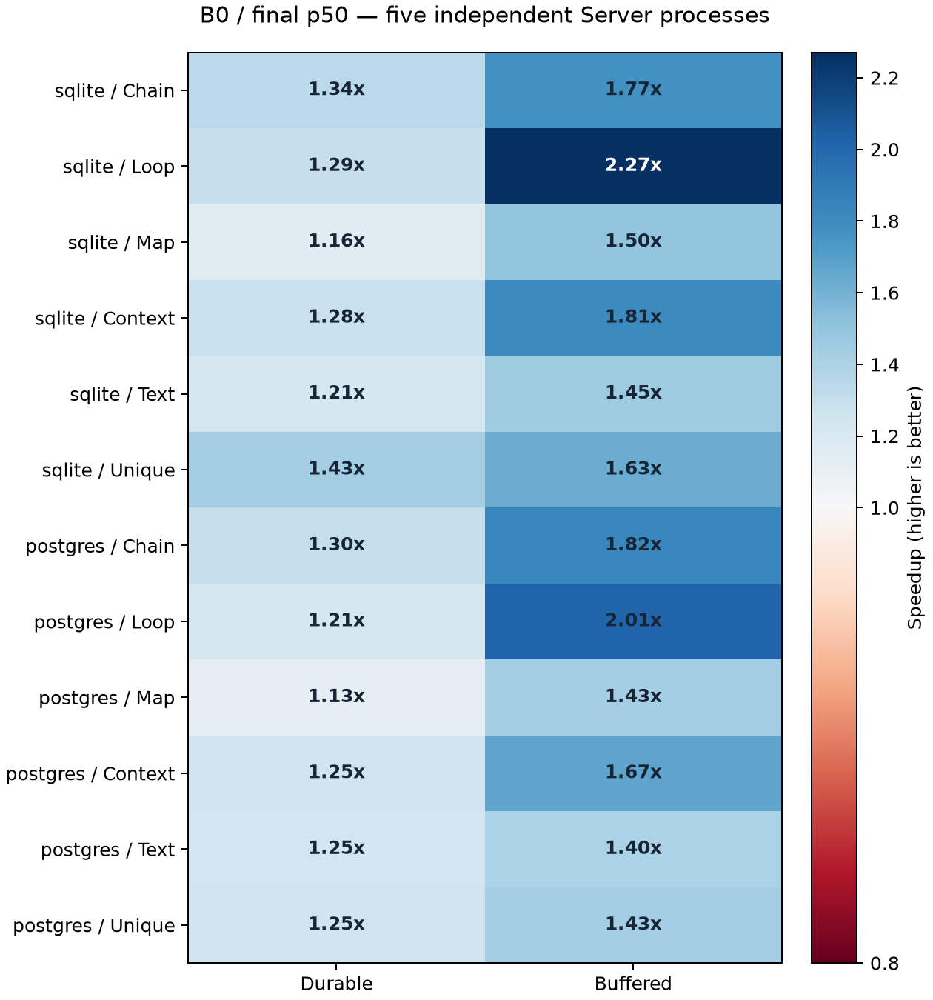

# 步骤 9：最终验收与优化前后对比

## 范围和结论口径

本轮重新运行未优化 B0、冻结的最终 V2，以及归档 V1 standard/full。所有版本都启动原生 Server，通过 HTTP 执行相同业务，完成观察及持久化屏障计入耗时；没有外部 LLM。B0 的源码逐文件匹配步骤 0 保存的 hash，使用同一版冻结控制器/Worker，不能把早先阶段的百分比相加当作累计收益。

主表 Artifact 阈值都是 8192 bytes。B0/最终 V2 分别使用 durable 和 buffered，默认提交等待保持 0 ms。每配置 5 个独立进程，普通场景每进程 20 次测量，unique-history 为 128 次，额外预热不计入正式调用。配置顺序按轮次交替，重型测试串行；共享主机无独占 CPU/cgroup 隔离。

V1 standard 不保留完整 StateOperation 历史；V1 full 的异步记录/flush 边界也不同于 V2 durable 每次状态转换提交后确认。V1 是当前同轮实测参考，数值差距不能直接解释为等价持久化语义下的 Runtime 算法差距。

两种后端、六场景等权几何平均：durable 的 B0/最终 p50 比值为 **1.26×**，对应归一化耗时减少 **20.4%**。这不是把不同场景混成一个总体请求分布。

两种后端、六场景等权几何平均：buffered 的 B0/最终 p50 比值为 **1.67×**，对应归一化耗时减少 **40.0%**。这不是把不同场景混成一个总体请求分布。




## 当前同轮速度

单位 ms；表中是五个独立进程请求 p50 的中位数。降低比例相对相同后端、相同模式的 B0。p95、每轮原值和配对变化见 comparisons.json/summary.json。

| 后端 | 场景 | V1 standard | V1 full | B0 durable | 最终 durable | 降低 | B0 buffered | 最终 buffered | 降低 |
| --- | --- | ---: | ---: | ---: | ---: | ---: | ---: | ---: | ---: |
| sqlite | chain-10-16k | 44.9 | 65.7 | 1083.5 | 806.2 | +25.6% | 435.4 | 245.4 | +43.6% |
| sqlite | loop-100-16k | 315.5 | 704.4 | 10870.2 | 8424.5 | +22.5% | 4993.4 | 2198.5 | +56.0% |
| sqlite | map-100-16k | 71.3 | 134.9 | 3311.7 | 2859.5 | +13.7% | 1432.7 | 955.1 | +33.3% |
| sqlite | context-append | 137.2 | 221.7 | 2815.8 | 2192.3 | +22.1% | 1176.2 | 648.8 | +44.8% |
| sqlite | text-overwrite | 534.0 | 1364.2 | 3232.1 | 2670.2 | +17.4% | 1699.2 | 1168.2 | +31.3% |
| sqlite | unique-history | 31.6 | 41.5 | 611.8 | 428.7 | +29.9% | 220.1 | 134.9 | +38.7% |
| postgres | chain-10-16k | 53.1 | 77.3 | 817.7 | 627.1 | +23.3% | 323.2 | 177.1 | +45.2% |
| postgres | loop-100-16k | 371.4 | 732.4 | 7719.2 | 6360.5 | +17.6% | 3515.1 | 1746.1 | +50.3% |
| postgres | map-100-16k | 82.8 | 139.5 | 2517.8 | 2230.8 | +11.4% | 1082.6 | 758.3 | +30.0% |
| postgres | context-append | 179.1 | 215.6 | 2032.5 | 1627.4 | +19.9% | 905.4 | 543.6 | +40.0% |
| postgres | text-overwrite | 670.8 | 1342.2 | 2590.6 | 2078.4 | +19.8% | 1357.3 | 967.9 | +28.7% |
| postgres | unique-history | 28.5 | 37.8 | 363.7 | 290.6 | +20.1% | 188.2 | 131.2 | +30.3% |

## Server 内存、CPU 和关闭后存储

RSS 是外部 20 ms 采样的运行期峰值；CPU 是测量区间 Server 进程累计 CPU/完成调用数，包含线程，排除 HTTP 控制器和 PostgreSQL 共享服务。不是单调用 CPU 的 p50。存储是关闭后的物理占用：SQLite 包含当时数据库/WAL/SHM，PostgreSQL 包含数据库分配、索引和 TOAST，未归因共享 WAL。自动 Checkpoint 时机不同产生的可变行数单列在 variable-counts.json。

| 后端 | 模式 | 场景 | CPU ms/调用 B0→最终 | 运行峰值 RSS MiB B0→最终 | 关闭后存储 MiB B0→最终 |
| --- | --- | --- | ---: | ---: | ---: |
| sqlite | durable | chain-10-16k | 946.5→707.0 | 93.9→94.5 | 12.25→12.28 |
| sqlite | durable | loop-100-16k | 9624.0→7463.5 | 98.7→101.3 | 93.71→93.95 |
| sqlite | durable | map-100-16k | 2924.5→2501.5 | 94.1→97.7 | 24.85→24.22 |
| sqlite | durable | context-append | 2476.5→1917.5 | 122.8→123.7 | 51.29→51.30 |
| sqlite | durable | text-overwrite | 2855.0→2326.5 | 134.4→131.1 | 458.75→458.79 |
| sqlite | durable | unique-history | 484.5→374.5 | 94.6→97.1 | 35.50→35.22 |
| sqlite | buffered | chain-10-16k | 436.5→249.0 | 97.2→96.8 | 12.75→12.55 |
| sqlite | buffered | loop-100-16k | 5155.5→2405.5 | 114.9→108.9 | 98.23→96.65 |
| sqlite | buffered | map-100-16k | 1495.5→984.5 | 103.9→99.2 | 25.17→24.90 |
| sqlite | buffered | context-append | 1205.5→691.0 | 134.4→135.5 | 53.09→53.64 |
| sqlite | buffered | text-overwrite | 1663.5→1182.0 | 174.1→168.9 | 459.76→460.01 |
| sqlite | buffered | unique-history | 214.3→131.7 | 96.6→98.7 | 35.93→35.94 |
| postgres | durable | chain-10-16k | 662.5→518.0 | 97.0→95.0 | 14.78→14.85 |
| postgres | durable | loop-100-16k | 6318.0→5127.5 | 101.2→107.4 | 66.67→67.39 |
| postgres | durable | map-100-16k | 2068.0→1862.5 | 95.8→99.9 | 23.47→23.67 |
| postgres | durable | context-append | 1678.5→1336.5 | 126.0→123.4 | 29.71→29.89 |
| postgres | durable | text-overwrite | 2150.5→1739.5 | 130.9→126.7 | 29.39→29.45 |
| postgres | durable | unique-history | 310.7→249.3 | 95.5→100.6 | 25.75→25.79 |
| postgres | buffered | chain-10-16k | 298.5→171.0 | 97.4→96.6 | 14.87→14.82 |
| postgres | buffered | loop-100-16k | 3345.0→1719.0 | 110.0→108.6 | 67.71→67.05 |
| postgres | buffered | map-100-16k | 1062.5→707.0 | 98.9→100.2 | 23.26→23.27 |
| postgres | buffered | context-append | 835.0→509.5 | 131.3→133.3 | 29.66→29.51 |
| postgres | buffered | text-overwrite | 1221.0→903.5 | 163.0→148.9 | 29.29→29.30 |
| postgres | buffered | unique-history | 151.3→99.8 | 94.5→94.8 | 25.71→25.46 |

V1 的 RSS/CPU/存储也按同一方式保留在 summary.json。主比较统一阈值，因此不把从默认 1 MiB 改为 8 KiB 的空间收益归到代码优化。不能因 CPU 和延迟下降就声称内存或储存同时按相同比例下降；缓存、额外索引和完整历史各有空间成本。文本使用高度可压缩的重复字符，跨库物理空间差异不能直接外推到图片、视频或随机内容。

## 整个 Server 生命周期的 RSS

OOM 风险也包含预热、空闲和关闭阶段。以下列出整个生命周期的外部采样峰值，单位 MiB，区别于上一节仅在正式负载期间取峰值。V1 使用默认 retain_all，没有测试其 LRU 变体；kernel VmHWM 与其他阶段数值也保留在 JSON。

| 后端 | 场景 | V1 standard | V1 full | B0 durable | 最终 durable | B0 buffered | 最终 buffered |
| --- | --- | ---: | ---: | ---: | ---: | ---: | ---: |
| sqlite | chain-10-16k | 85.6 | 91.5 | 94.3 | 95.1 | 97.5 | 97.1 |
| sqlite | loop-100-16k | 172.3 | 226.6 | 99.5 | 102.6 | 115.0 | 109.4 |
| sqlite | map-100-16k | 86.5 | 138.3 | 94.3 | 98.1 | 104.6 | 99.2 |
| sqlite | context-append | 123.3 | 133.2 | 123.1 | 124.1 | 134.4 | 136.1 |
| sqlite | text-overwrite | 666.0 | 570.4 | 134.4 | 131.1 | 174.1 | 168.9 |
| sqlite | unique-history | 99.5 | 117.5 | 95.0 | 97.6 | 96.6 | 99.1 |
| postgres | chain-10-16k | 89.5 | 93.8 | 97.3 | 95.7 | 97.5 | 97.2 |
| postgres | loop-100-16k | 167.9 | 225.0 | 102.7 | 108.4 | 110.5 | 109.4 |
| postgres | map-100-16k | 89.5 | 137.7 | 96.0 | 100.0 | 99.3 | 100.9 |
| postgres | context-append | 123.7 | 134.1 | 126.6 | 123.9 | 132.5 | 134.0 |
| postgres | text-overwrite | 636.4 | 567.3 | 130.9 | 126.7 | 163.0 | 148.9 |
| postgres | unique-history | 101.8 | 119.5 | 96.0 | 101.2 | 95.1 | 95.4 |


## SQL 机制

独立诊断不混入正常延迟。每组 5 次 Chain 调用，减去预热快照；实际 driver COMMIT 包含诊断区间的其他写事务。阶段耗时互相嵌套，不能相加。

| 后端 | 模式 | 版本 | SQL | SELECT | driver COMMIT | 写批次 | Runtime Event |
| --- | --- | --- | ---: | ---: | ---: | ---: | ---: |
| postgres | buffered | b0 | 3185 | 2533 | 30 | 10 | 310 |
| postgres | buffered | final | 853 | 756 | 33 | 10 | 310 |
| postgres | durable | b0 | 6730 | 4230 | 364 | 310 | 310 |
| postgres | durable | final | 3985 | 1780 | 355 | 310 | 310 |
| sqlite | buffered | b0 | 3684 | 2692 | 30 | 10 | 310 |
| sqlite | buffered | final | 1363 | 924 | 35 | 10 | 310 |
| sqlite | durable | b0 | 7477 | 4291 | 376 | 310 | 310 |
| sqlite | durable | final | 4739 | 1863 | 361 | 310 | 310 |

## 长时稳定性：一组完整、一组提前结束、两组未执行

原计划对最终版本做四组长时验收；用户要求加快结束后，SQLite durable 完成 3600 秒，SQLite buffered 运行约 53.5 分钟时主动中止，两个 PostgreSQL 长测未执行。仅完整一组进入下表及正式验收统计，部分数据单列在 accelerated-finish.json；不能称为四组长测全部通过。未对 B0/V1 重跑一小时，不能据此宣称长期增长率比 B0 降低。完整组以真实单调时钟持续至少 3600 秒，calls 不作为结束条件，目标每秒一请求。每次创建新 Session、变化 16 KiB 内容，轮换 64 个 Workflow/Revision；保留默认驻留与缓存预算，驻留上限 128。每 60 次调用记录队列、frontier、驻留数与缓存计数。不是所有调用反复命中同一个小对象，也不是连续生成无限新 Workflow Revision。

后半段斜率用第 30–59 分钟的分钟平均 RSS 做线性拟合，单位 MiB/小时；它是观测趋势，不是长期外推的泄漏速率。起末 15 分钟使用分钟均值的中位数。默认内存监控关闭，观测来自外部采样和基准专用标量端点。

| 后端 | 模式 | 实际负载秒数 | 完成调用 | 调用/s | 峰值 RSS MiB | 首/末 15 分钟 RSS MiB | 后半段斜率 MiB/h | 关闭后存储 MiB |
| --- | --- | ---: | ---: | ---: | ---: | ---: | ---: | ---: |
| sqlite | durable | 3600.0 | 3600 | 1.000 | 124.2 | 118.6/124.2 | +2.85 | 873.2 |

提前结束的 SQLite buffered 已完成 3212 次调用，观测负载 3211.3 秒，全生命周期采样峰值 RSS 123.6 MiB。最后一次健康采样队列为 0、accepted/durable frontier 一致、无故障。控制器的 KeyboardInterrupt 来自主动收尾，不是运行故障；部分组不计为一小时验收通过。

所有完整分钟数据和健康记录见 details.json。有限一小时结果不能证明任意业务、大 payload、无限循环或真实 SDK 都不会 OOM；保留全部历史时数据库随完成调用增长是预期行为，RSS 与数据库增长需分开判断。

达到驻留上限后，卸载保存的 Checkpoint 会保守清空图/元数据缓存（Storage 的提交路径），因此长时健康记录中的缓存可能仅剩最近 Invocation 的条目。本轮没有把这种负载当作全缓存命中的测试，也没有对 B0 同轮跑一小时；短场景的累计加速比例不能直接当作长期满驻留场景的吞吐收益。

## 专项与正确性

默认 Artifact 阈值、条件历史、128 Node 重复图、8 Session 并发、20 ms 慢库分别三轮配对；Wait/Resume、在 durable Wait 杀进程后恢复、注入存储故障各独立验证。缓存压力用 16 KiB 图/元数据预算和 64 个定义轮换、128 次唯一调用；队列/缓存高水位、淘汰数、故障健康信息及所有成功/失败状态均保留。

本轮正式结果包含 529 组已接受的 Server 运行（不含提前中止组）、19147 次已完成正式调用，包含 8 次预期注入故障；预热、完整单测自身启动的 Server 不计入此数。规范事实/投影行数配平和关闭后 SQLite/PG 事实审计错误 0 项。Checkpoint/Artifact/引用数量差异未隐藏。历史固定位置重建、关闭重开、Fork、子调用、Checkpoint 与 Agent recording 由完整 V2 测试覆盖。

完整测试按模块独立进程执行，避免前面大数据测试的 Python arena 干扰后续 Host admission：103 个模块、1764 项，其中 PostgreSQL 321 项，跳过 0 项。

**完整功能验收仍有失败，不能称为全绿。**

- `tests.test_deepseek_weather_example`：FAIL: test_server_cli_api_history_and_ui_for_both_backends (tests.test_deepseek_weather_example.WeatherCliTests.test_server_cli_api_history_and_ui_for_both_backends) (backend='openai')；FAIL: test_server_cli_api_history_and_ui_for_both_backends (tests.test_deepseek_weather_example.WeatherCliTests.test_server_cli_api_history_and_ui_for_both_backends) (backend='litellm')。

天气旧模块入口的两个失败子场景若仍存在，与步骤 4–8 已记录的问题同源；本轮未恢复已删除的示例入口或添加兼容层。完整日志保留在私有 verification/，结构化结果见 verification.json。


冻结工具的首轮预检曾暴露 V1 路径定位依赖 Worker 自身位置的问题：复制工具后会错误定位归档根目录。已改为控制器显式传入 repository_root，并增加两个数据库上的冻结 V1 工具回归；先前预检留在 step-09-preliminary/，未计入正式延迟。产品 V1 和 V2 源码均未为此更改。

最初的存储故障专项只调用一次、让第二个写批次失败；buffered 可将整个短 Invocation 合并为第一个批次，故障于是延迟到关闭 Checkpoint 时。那次调用及屏障已成功，但关闭正确报错，不能假称“测量期间已观察故障”。三组初始故障探针（两组 durable、这一组 buffered）原样保留在 fault-fixture-preliminary/，与正式结果分列。后续统一改为两次串行调用，强 flush 后再开始第二次，确保第二写批次在测量期间触发；只修正测试入口的一行参数，四个测量工具及产品快照未变，360 组正式性能结果未受影响。修订 hash、移动索引和原因见 entry-revisions.json。

## 来源、限制与复现

B0/最终完整包及测试工具分别冻结，provenance.json 列出全部 hash、依赖与 27 个阶段源码差异。期间包含未在该合成负载中调用的 Agent/trace 功能变化，不能把所有 RSS 或启动差异都精确归因于某一优化函数；当前工作区与冻结包的晚期差异另存 final-alignment.json。本轮没有修复步骤 8 发现的高并发观察查询放大；并发专项仍包含该问题，不能用 join 隔离结果替代默认观察路径的速度。

```bash
.venv/bin/python -m tests.postgres start
.venv/bin/python -m tests.benchmarks.server_comparison.acceptance --phase all
.venv/bin/python -m tests.benchmarks.server_comparison.acceptance_report
```

默认原始目录 `.autoagent/performance/v2-optimization/step-09/`。源快照、逐调用记录、RSS、Server 日志、运行配置和测试日志均保留；本地数据库连接不复制到公开报告。可用 --directory 指定新的空目录复测，已存在的运行不覆盖；verify/formal/extras/diagnostic/soak 支持分阶段续跑，必须串行。

步骤 8 的额外等待方案未保留，因此不产生新的累计加速。步骤 6 的独立 SQLite Loop 不利复核也仍是历史记录，本轮累计对照不用于删除或改写该负面样本。
