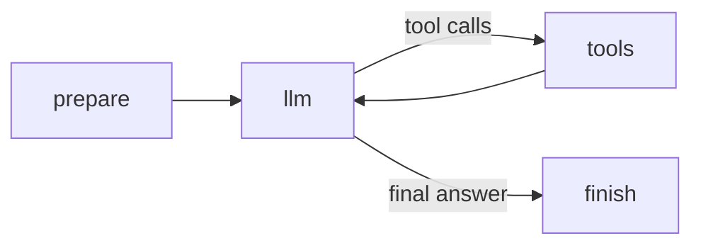

# DeepSeek 天气助手

使用真实 DeepSeek API，通过本地 Tool 查询固定的模拟城市和天气数据。
支持北京、上海、杭州、广州、深圳、成都，以及今天和明天。
以 Server 为入口，在 UI 或 API 中启动并查看 Workflow。

## 配置和启动 Server

在仓库根目录运行；使用当前虚拟环境：

```bash
uv pip install -e '.[cli,server,agent]'
# 选择 LiteLLM 时再安装这个可选依赖：
uv pip install -e '.[litellm]'
cp -n examples/deepseek_weather_assistant/.env.example examples/deepseek_weather_assistant/.env
```

在示例 `.env` 中填写密钥，其他默认值已准备好：

```ini
AUTOAGENT_LLM_PROVIDER=deepseek
AUTOAGENT_LLM_BACKEND=openai
AUTOAGENT_LLM_MODEL=deepseek-flash
AUTOAGENT_LLM_API_KEY=
```

`openai` 使用 AutoAgent 的 DeepSeek 适配和 OpenAI SDK；`litellm` 使用 LiteLLM 的
DeepSeek 路由。两者采用相同的请求、Tool Schema 和 Workflow。
Host 负责读取 `.env`、创建客户端、绑定 `LLM_CALL` 并在退出时关闭客户端。
密钥只留在连接配置中，不进入 LLMRequest、Workflow 定义或执行输入。

```bash
autoagent --project examples/deepseek_weather_assistant server
# 等价的 Python 入口：
.venv/bin/python -m examples.deepseek_weather_assistant
```

启动后打开终端打印的 UI 地址，默认是 http://127.0.0.1:8765/。
切换到 **Executions**，点击 **New Session and Run**，选择已注册的
`weather-assistant` 和 `prepare` 入口，再输入：

```json
{"question":"北京和上海明天天气怎么样？比较一下出行建议。"}
```

也可问“支持哪些城市？”、“杭州今天出门需要带伞吗？”或“巴黎明天天气怎么样？”。
查看 Invocation 的图、Node、Operator Call、输入输出和错误；天气结果明确标注“模拟天气”。
Ctrl+C 会停止接收请求、保存 Host 状态并关闭客户端。

切换后端后重启 Server：

```bash
AUTOAGENT_LLM_BACKEND=litellm autoagent --project examples/deepseek_weather_assistant server
```

Python module 入口支持同样的 Server 参数，例如 `--port 8000`、`--no-ui`、
`--no-access-log`、`--log-level warning`、`--debug`。Server 默认输出 INFO 及以上日志，
并开启 HTTP access log；第三方 SDK 默认保留 WARNING，选择 DEBUG 才输出详细 SDK 日志。
结构化输出使用 `--format json`，日志始终进入 stderr。
日志时间使用宿主机本地时区，包含日期、时分秒和时区偏移。

## 通过 CLI 调用运行中的 Server

```bash
autoagent --server http://127.0.0.1:8765/api/v2 invoke weather-assistant \
  --entry-node prepare \
  --input-json '{"question":"北京明天天气怎么样？"}' \
  --wait terminal
```

记下返回的 Invocation ID：

```bash
autoagent --server http://127.0.0.1:8765/api/v2 invocation nodes INVOCATION_ID
autoagent --server http://127.0.0.1:8765/api/v2 invocation calls INVOCATION_ID
autoagent --server http://127.0.0.1:8765/api/v2 invocation value INVOCATION_ID --field output
autoagent --server http://127.0.0.1:8765/api/v2 invocation diagnose INVOCATION_ID
```

Server 持有数据库写入权时，使用 `--server` 提交调用。
离线检查不启动客户端，也不需要密钥：

```bash
autoagent --project examples/deepseek_weather_assistant project check
autoagent --project examples/deepseek_weather_assistant workflow compile weather-assistant
```

## Workflow 如何拆分



- `prepare`：将问题和系统提示组成完整 `LLMRequest`，通过 Host 的 `llm_request()`
  补上默认模型和 token 配置，并将请求写入 Invocation Context。
- `llm`：普通 `Node("llm", LLM_CALL, ...)`。Input Mapping 从 Context 恢复请求；
  Output Binding 检查响应，将完整 `response.output` 加入历史并记录轮次。
- `tools`：`ToolSet.as_operator()` 配合 `Map` 执行这一轮的 Tool Calls，最多并发四个；
  每个 Call 独立可查。Output Binding 将 Tool Results 加入历史，随后回到 `llm`。
- `finish`：返回 `answer`、`model`、`model_calls` 和 `weather_source`。

三个 Tool 是 `list_cities`、`resolve_city`、`get_weather`。Tool 参数错误和业务错误成为
可供 LLM 读取的 Tool Result。LLM 最多调用六轮，最后一轮仍要求 Tool 时立即失败；
Node 的 `ResourcePolicy` 也限制启动次数。超时、重试、Map 并发数属于 Workflow 定义。
这是用基础 Node 模拟的对话循环，没有新增 ReAct Agent 或专门的 LLM Node 类型。

## 流式调用和 User Event

```ini
AUTOAGENT_LLM_STREAMING=true
```

重启后，Provider 使用流式 API。`LLM_CALL` 的默认 Reducer 保留权威的终态响应，
Node 最终仍返回完整 `LLMResponse`，包括 Tools、Usage 和协议扩展字段；
无需在 Node 上配置 `LLMStreamReducer`，也不会自动产生 User Event。

如需面向用户的逐字事件，在 `llm` Node 上配置一个 Mapper：

```python
from autoagent import UserEventContext, UserEventSpec


def llm_events(context: UserEventContext) -> UserEventSpec | None:
    if context.phase == "chunk":
        chunk = context.value
        if chunk["type"] == "delta" and chunk["kind"] == "text":
            return UserEventSpec(kind="answer.delta", payload={"text": chunk["delta"]})
        return None
    return UserEventSpec(kind="answer.completed", payload=context.value)

# Node("llm", LLM_CALL, ..., user_events=llm_events)
```

同一个 Mapper 分别处理 Chunk 和最终 Output，完成事件只在 Output 阶段发一次。
示例本身未配置 Mapper，UI 仍可查看 Runtime Trace 和最终业务输出。

## 在自定义 Operator 中使用

默认请求构造也可用于普通 Operator；`LLMRequest(model=..., ...)` 仍可直接使用：

```python
from autoagent.agent import LLMMessage, TextContent
from autoagent.host import llm_request

request = llm_request(
    input=(LLMMessage(role="user", content=(TextContent(text="你好"),)),),
)
# request.model 已经确定，可交给 LLM_CALL 或调用自己持有的 provider.ainvoke(request)。
```

Embedding 使用独立的 `AUTOAGENT_EMBEDDING_*` 配置，由 Host 自动绑定 `EMBEDDING`。
`embedding_request(input=("一段文字",))` 补全模型；空的 MODEL 不创建客户端。
项目 lifespan 已注册的自定义实现优先，Host 不替换它，也不会自动切换模型或 Provider。
